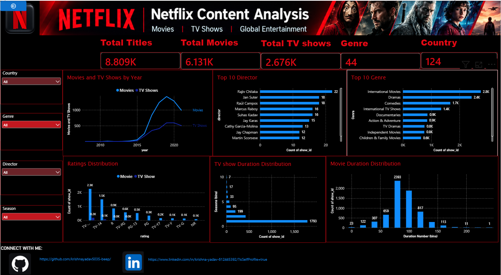

# 🎬 Netflix Content Analysis Dashboard

## 📌 Project Overview

The **Netflix Content Analysis Dashboard** is a data visualization project designed to explore and analyze Netflix movies and TV shows. It provides insights into content distribution, genres, ratings, directors, release years, and durations through interactive visualizations.

The main objective of this project is to transform raw Netflix data into meaningful insights that help users understand Netflix's content library.

## 🖼️ Dashboard Preview

## 🎯 Project Objectives

- Analyze Netflix movies and TV shows.
- Understand content distribution by year.
- Identify the most common genres.
- Explore top directors on Netflix.
- Analyze content ratings.
- Examine movie durations and TV show seasons.
- Explore content using interactive filters.

## 📊 Dashboard Features

### 1. Key Performance Indicators (KPIs)
- Total Titles
- Total Movies
- Total TV Shows
- Genre Analysis
- Country Analysis

### 2. Movies and TV Shows by Year
Visualizes the distribution of movies and TV shows across different years.

### 3. Top 10 Directors
Identifies directors with the highest number of titles in the dataset.

### 4. Top 10 Genres
Displays the most common content genres on Netflix.

### 5. Ratings Distribution
Analyzes the distribution of content across different age-suitability ratings.

### 6. TV Show Duration Distribution
Examines the number of seasons across TV shows.

### 7. Movie Duration Distribution
Analyzes movie lengths in minutes.

### 8. Interactive Filters
Allows users to explore the dashboard using available country, genre, and director filters.

## 🛠️ Tools and Technologies

- Microsoft Power BI
- Data Visualization
- Data Analysis
- Netflix Titles Dataset

## 📈 Key Learnings

Through this project, I gained practical experience in:

- Analyzing structured datasets.
- Creating interactive dashboards.
- Visualizing data using charts and graphs.
- Understanding content distribution and patterns.
- Presenting data insights in a clear and meaningful way.

## 🚀 How to Explore the Project

1. Open this GitHub repository.
2. View the dashboard screenshot in the repository.
3. Download the Power BI `.pbix` file if it is included.
4. Open the `.pbix` file using Microsoft Power BI Desktop to explore the interactive dashboard.

## 👨‍💻 Author

**Krishna Yadav**

- GitHub: [krishnayadav5035-beep](https://github.com/krishnayadav5035-beep)
- LinkedIn: [Krishna Yadav](https://www.linkedin.com/in/krishna-yadav-612445392/)

---

⭐ If you find this project interesting, feel free to explore the repository!

*This project was created for learning and portfolio development in Data Analytics and Data Visualization.*
